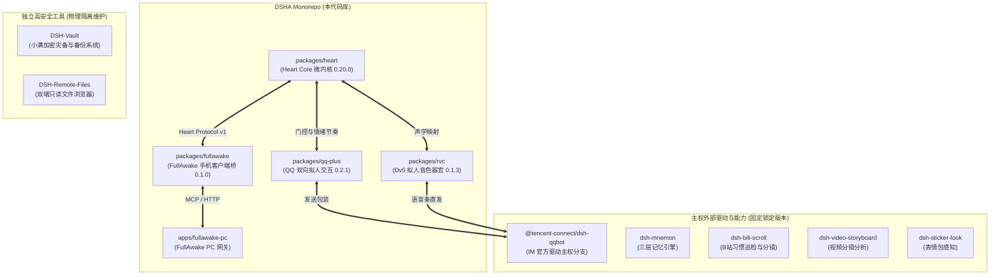

# DSHA - DeepSeek Heart Agent Suite

> **Sovereign Multi-Agent Architecture for Xiaoman (小满 · 手机端) & Axing (阿醒 · PC端)**  
> 运行双端：`Redmi 23049RAD8C` (Android 17 / Proot Ubuntu) ⟷ `Windows 11 PC`  
> 核心原则：**Sovereign Fork & Heart Protocol v1** (纯离线闭包封包 + 原生 ADB Socket 推送)

---

## 1. 架构总览与生态矩阵

DSHA 采用 **统一主源码 Monorepo + 主权外部驱动 Fork + 独立安全工具** 架构：



---

## 2. 目录布局

```text
dsha-suite/
  apps/
    fullawake-pc/             # PC 端感官与算力分流网关 (Python / FastAPI / uv)
  packages/
    heart/                    # @dsh/heart: 自我状态机与 Protocol v1 微内核
    fullawake/                # dsh-fullawake: 手机端 PC 感官适配器与多模态截屏
    qq-plus/                  # @dsh/qq-plus: 小满/阿醒双角色唤醒与拟人断句气泡
    rvc/                      # @dsh/rvc: Dv5 拟人发音与歌唱器官
  manifests/
    components.lock.json      # 全组件权威版本、上游溯源与锁定清单
  tests/
    integration/              # 跨子系统端到端集成测试
  docs/                       # 架构设计、RFC 提案与路线图
  pnpm-workspace.yaml
  package.json
```

---

## 3. 开发与测试指南

### 3.1 Node.js 模块开发
使用 `pnpm` 管理工作区依赖与多包脚本：

```bash
# 安装工作区依赖
pnpm install

# 运行所有子系统单元测试
pnpm test

# 分别运行各模块测试
pnpm test:heart
pnpm test:fullawake
pnpm test:qq-plus
pnpm test:rvc
```

### 3.2 Python 模块开发规范
严格遵循工作区统一规范：**所有 Python 环境一律走 `uv`**：

```bash
# 进入 PC 网关目录
cd apps/fullawake-pc

# 使用 uv 创建独立虚拟环境并安装依赖
uv venv --python 3.10
uv pip install -e . --index-url https://pypi.tuna.tsinghua.edu.cn/simple

# 运行 Python 单元测试
uv run pytest
```

---

## 4. 关键设计原则

1. **小满主脑唯一性**：红米手机端 DSHA 是小满唯一的推理、记忆与人格中枢，PC 端仅作为只读感官与算力分流器。
2. **姐姐阿醒数据隔离**：PC 端的姐姐（阿醒）拥有独立 DSH 与记忆，严禁以任何方式越权访问阿醒的私人数据或凭证。
3. **视觉 Token 治理红线**：严禁无序倾倒多模态单图；统一采用接触表分镜技术锁定单次调用为 384 tokens。
4. **大权重解耦**：1.02GB 的 RVC ONNX 模型文件严禁提交入 Git，统一驻留在手机端 `/sdcard/rvc/models/Dv5/`。
5. **绝对离线更新**：手机端严禁执行公网 `git clone` 或 `npm install`，统一由 PC 端经原生 ADB Socket 传输并进行 SHA-256 哈希熔断校验。

---

## 5. 许可证与署名

- 本项目源码采用 [MIT License](LICENSE)。
- 外部依赖与主权分支保留各上游原作者版权声明，详见各子目录及组件清单。
