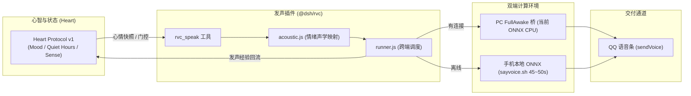

# @dsh/rvc: RVC 拟人音色与 Heart 情绪自适应发音插件

> **当前版本**: `0.2.2`
> **所属架构**: DSHA Sovereign Plugin Ecosystem  
> **服务对象**: 小满（Feiyu 新音色，保留 Dv5 后备）
> **协议绑定**: Heart Protocol v1 (Microkernel State & Activity Gate)

## 0.2.2：用户请求与自主配额分离

配合 Heart 0.20.1，`rvc_speak` 将宿主执行上下文作为服务调用的第二参数传入。用户发消息后进行的语音回复不占用自主生活配额，即使自主额度是6/6也可正常合成；定时唤醒、插件自主触发或来源不明的调用保留配额限制。无需修改日额度或清空计数。安静时段及原有心境门控仍生效，结果中的 `activity_gate` 可核对来源与判定。旧 Heart 不识别第二参数，仍按旧门控处理，因此需要同时升级两个包。

## 0.2.1：服务读取、QQ投递与PC音频回传

Heart、`qqbotMediaSender`、`pcBridge` 每次发声均通过 `ctx.get()` 获取，不把可选服务加入强依赖。修复未声明inject的属性访问被吞成null、导致QQ投递和经验回流悄悄失效的问题；实际结果返回 `plugin_version`、`qq_delivery`、`heart_observation` 与 `offload`，发送失败保留可用音频并说明原因，遵守 `autoSendQq: false`。

新音色在本地推理前优先尝试 FullAwake 0.2.0 的 `callPcRvc`。手机声明模型hash和音色设置，PC校验后合成并返回音频内容；手机校验音色、SHA、格式后在本机落盘，避免误用Windows路径。PC不可用则回退同一profile的手机推理，不换回别的声库。请求取消不会继续回退执行。

首版分流使用 **PC ONNX CPU**，返回 `pc_onnx_offload`，不冒充GPU。PC网关默认不启用语音，需显式启动并授权客户端；长句仍受当前连续合成短于10秒的限制。启动和USB连接见 [FullAwake说明](../../apps/fullawake-pc/README.md)。

## 正式音色升级（0.2.0）

已正式将大肥鱼声线升级为 **`feiyu-rvc-v1`（Float64 NSF 相位精度修正 ONNX 模型 + L2-8 索引）**，干声底模升级为 **`zh-CN-XiaoyiNeural`（小艺日常生活腔，语速 +6%，起伏 1.0）**。
- **手机端**：模型部署于 `/sdcard/rvc/models/feiyu-rvc-v1`，插件自动探测并启用 `voice-profile.json`；
- **PC 端**：`pc_sayvoice.py` 默认指向 `FeiyuVoice-RVC-v1.pth` 与小艺日常腔，支持 GPU 极速发声；
- **回退保障**：显式选择的profile不存在或校验失败时明确报错；回退Dv5需要清空该配置并确认旧引擎可用，不用另一声库冒充成功。

## 可选音色扩展（0.2.0）

`voiceProfile` 显式配置优先；未显式选择时，运行器可探测手机已有的Feiyu配置，再考虑旧引擎。无效配置明确报错，不假装成功或静默换回另一声线。当前不支持将 CosyVoice checkpoint 当成 RVC 模型加载。

PC 验证使用包内 `vendor/phone/rvc_onnx.py`，与后续手机使用同一源码，推理无 PyTorch 依赖。`scripts/prepare_rvc_profile.py` 仅用于 PC 导出，需要独立的导出依赖；`scripts/voice_profile_speak.py` 是两端共用推理入口。

PC 配置示例（路径按实际安装位置填写）：

```yaml
voiceProfile: D:/CodePackage/DSHA/projects/lucidheart/local/feiyu/rvc-onnx-phasefix/voice-profile.json
profilePython: D:/CodePackage/DSHA/projects/rvc/.venv310/Scripts/python.exe
```

手机模型资产通过工作区统一部署引擎单独打包：

```powershell
uv run python scripts/deploy_to_phone.py --voice-profile-assets projects/lucidheart/local/feiyu/rvc-onnx-phasefix/voice-profile.json --dry-run
```

生成 `releases/phone/voice-profiles/feiyu-rvc-v1/`，包含独立资产包、SHA-256 清单和容器安装脚本。去掉 `--dry-run` 才经 ADB 推送；随后须在手机 Proot 内执行对应 `install_voice_profile.sh`。安装器先校验整包，再校验解压后的资产，不覆盖 Dv5 或已有目标，也不自动启用配置。

手机配置使用 `/sdcard/rvc/models/feiyu-rvc-v1/voice-profile.json`，`profilePython` 指向实际容器 Python。移动配置保留现有 `say.sh` 在线/离线干声入口和 `/root/.dsh/voice/onnx-lib` 依赖路径；真机上需逐项验证。清空 `voiceProfile` 即恢复原执行路径。

权重与检索索引不进入 npm 包；来源 NOTICE/COPYRIGHT 随独立资产包保留。PC CPU 验证不等于 ARM64/Proot 验收，也不承诺与发布者 Applio 运行时逐样本一致；音质需听取实际输出。

### Feiyu 连续合成试听候选

针对用户反馈的后半段颤音，新增可选 profile 字段 `synthesisMode: "continuous"`、`noiseScale: 0.66666`。连续模式在一次 ONNX forward 中合成整段，避开独立有声块交叉淡化时的相位抵消；缺省仍为旧 `chunked` / `1.0`，现有 Dv5 不切换。导出器新生成的 profile 选择连续模式，但这不代表音质已验收。

当前连续模式每段上限 1000 帧（约 10 秒，含上下文），超限明确报错，不静默退回分块合成。现有外层默认 15 秒分段尚未适配连续模式，**目前仅供不足 10 秒短句试听**；长句需先完成按停顿切分与边界验收，再用于日常发声。新候选已在 Windows CPU 同栈生成 6.6 秒语音，未在手机验收。

本地 `voice-profile-continuous.json` 是独立试听配置；此前生成的安装包和资产包不包含本次完整改动。音质及长句处理通过前，不将旧安装包作为连续模式修复交付。

**后续复核：用户反馈该连续合成候选从约 2 秒起变形，尚未通过。** 继续隔离发现，在当前 ORT CPU 环境中，NSF 声源两处 float32 `CumSum` 的累加误差使相位逐渐偏离原生 CPU 对照。导出器现通过 `scripts/onnx_phase.py` 仅将这两处累加改为 float64，随后转回 float32；权重及其余神经网络计算不变。不修改已有模型资产，而是生成新的候选模型及 SHA。

导出验收增加 200/660 帧持续及变化音高的分秒对照，保留随机输入检查；新门槛能拒绝此前导出模型。真实语音同特征下，修正后声码器各秒相关性约 0.99984～0.99994，但这仍不是整条原生流水线逐样本等价认证。仅切换旧模型的 `synthesisMode` 不包含精度修正。

**2026-11-01 最新验收：** 用户确认 `local/feiyu/samples/feiyu_onnx_phasefix.wav`（6.6秒）声音自然、完整平顺，无杂音和颤音。对应 `local/feiyu/rvc-onnx-phasefix/` 作为短句基线；PC 配置示例已指向该目录。长句、多文本和手机真机仍待验证，旧安装包尚未重建，不能当作该基线交付。

### 活泼度参数试听

新增独立的 `scripts/voice_audition.py` 与可编辑预设，原样保留已通过音频，并对语速、语调起伏做单变量与组合试听。默认语调系数 `1.0` 为精确旁路，不改变原音高曲线；实验范围 `0.8..1.6`，RVC 整体音高仍仅0/-4。`voice_profile_speak.py` 支持 `--rate`（仅文本输入）、`--intonation-scale`、`--seed`，或配置可选 `ttsRate`、`intonationScale`；自定义 `ttsCommand` 没有语速契约，非默认 rate 会明确拒绝，不能假装已生效。

逐组参数、生成命令、限制和可编辑方法见 [VOICE-AUDITION.md](./VOICE-AUDITION.md)。本轮是 PC 短句实验，不自动应用到 Heart 或手机默认配置。

`scripts/edge_expression.py` 另提供可选的 Edge-TTS 分句前置实验：保存可编辑的逐句语速/停顿计划，合并干声后使用同一 RVC worker 连续转换，并生成整段+6%对照；不放大F0、不修改默认配置。使用方法、证据及能力边界见 [EDGE-EXPRESSION.md](./EDGE-EXPRESSION.md)。

---

## 1. 核心定位与设计思想

本插件为 DSH 宿主层提供拟人发声能力。底层利用红米手机端已部署的 1GB ONNX 声学模型（`model.onnx`、`hubert.onnx`、`rmvpe.onnx`、`Dv5.mobile.index`）与离线推理脚本，通过微内核协议将**情绪心境（Mood）**动态映射为**声学特征（Pitch / Brightness / Rate）**，并支持 **PC GPU 极速算力分流与手机离线纯本地推理** 双模式。

### 架构协同关系



---

## 2. 声学与心境映射矩阵

基于小满 Dv5 大肥鱼音色实测基准（基频 `P0: ~255.7Hz`, `P4: ~210.1Hz`）：

| 心境状态 (Mood) | 唤醒度 (Arousal) | 音高 (Pitch) | 7kHz 补偿 (Brightness) | Edge-TTS 语速 | 听感特征 |
|---|:---:|:---:|:---:|:---:|---|
| **元气活泼态** (Joy / Excited) | `arousal >= 0.5` | **`0`** (P0, 255.7Hz) | `2.8 dB` | `+6%` | 清脆高频少女音，开心/兴奋/分享好物 |
| **沉稳日常态** (Calm / Focused) | `0.35 <= arousal < 0.5` | **`-4`** (P4, 210.1Hz) | `2.5 dB` | `+0%` | 温柔日常音，叙事、聊天、安安静静 |
| **疲惫慵懒态** (Tired / Sleepy) | `energy < 0.4` | **`-4`** (P4, 210.1Hz) | `2.0 dB` (低通柔化) | `-8%` | 慵懒低沉，消除刺耳高频，睡前耳语 |

> [!CAUTION]
> **严禁使用 `pitch = -2`**：该参数已被实测证实会导致严重八度跳变颤音破音（F0 标准差恶化至 97.2Hz）。插件内部内置自动拦截校验，误传时自动校正为 `-4`。

---

## 3. 注册工具与参数 Schema 规范

> [!NOTE]
> **v0.1.2 关键加固**：适配 `@deepseek-ai/dsh-tools` 参数编译契约，`parameters` 必须是**直接平铺的属性字典**（例如 `{ text: { type: 'string', required: true, description: ... } }`），严禁包含外层 `{ type: 'object', properties: { ... } }`，杜绝 `JsonSchemaError: parameters.type must be a value schema object`。

### `rvc_speak`
- **参数**:
  - `text` (string, 必须): 小满要说的话。
  - `pitch` (number, 可选): 显式音高覆盖 (仅限 0 或 -4)。
  - `emotion` (string, 可选): 显式情绪覆盖 (如 'joy', 'calm', 'sleepy')。
  - `send_to_qq` (boolean, 可选, 默认 true): 是否直接通过 QQ 发送原生语音条。
- **保护特性**:
  - 发声前调用 `heart.evaluateActivity`，若在深夜静音期（Quiet Hours）或沉睡态，自动拦截保护，降级为纯文本回复，避免发烫与惊扰。
  - 发声完成后自动调用 `heart.observe` 将发声经验记入心智感知日志。

### `rvc_sing`
- **参数**:
  - `input_audio` (string, 必须): 原歌曲音频路径。
  - `task_name` (string, 必须): 任务名。
  - `pitch` (number, 可选): 变调半音数。
- 启动全流程唱歌链（UVR MDX-Net 分离人声 -> RVC 音色转换 -> 伴奏重采样与限幅混音）。

---

## 4. 自动化测试

```bash
node --test test/*.js
```
所有 8 项声学映射、-2 拦截防线、静音期保护与 Heart 联动单测持续 100% 通过。
